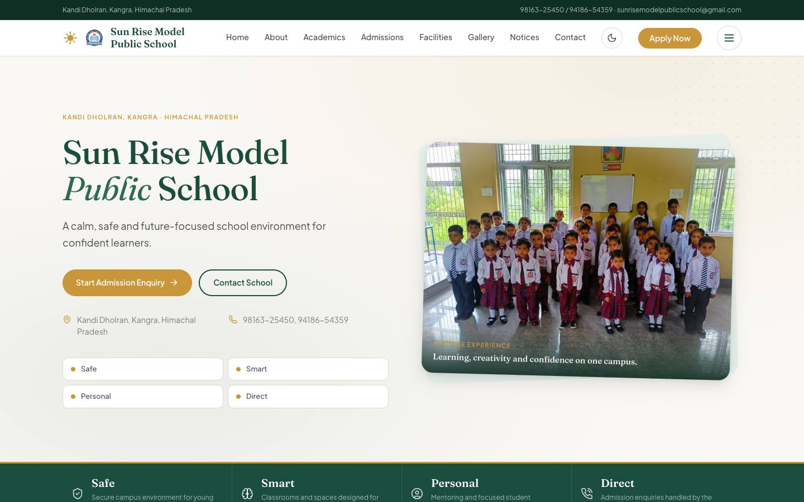
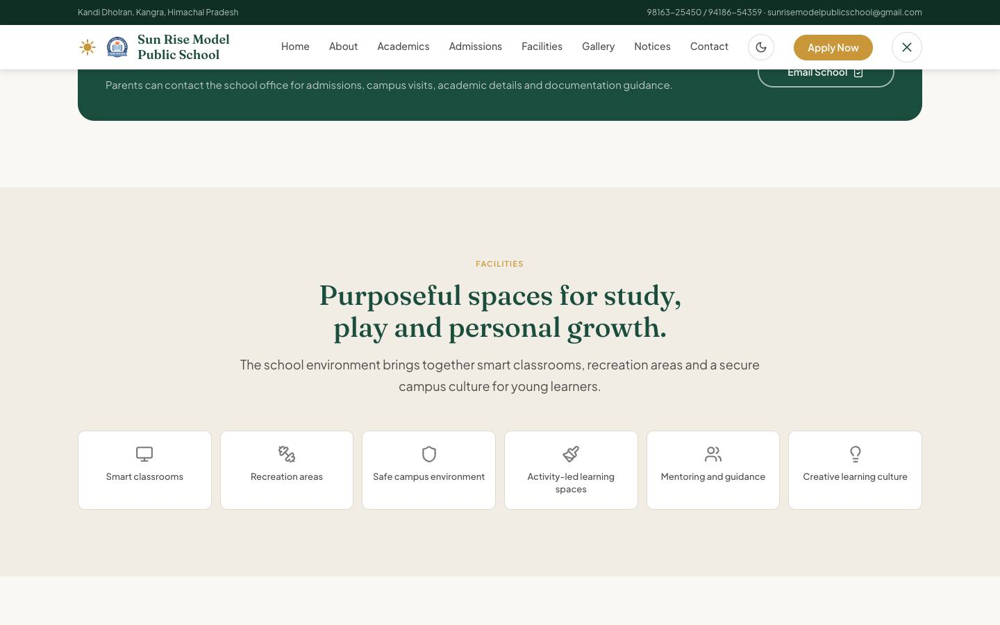
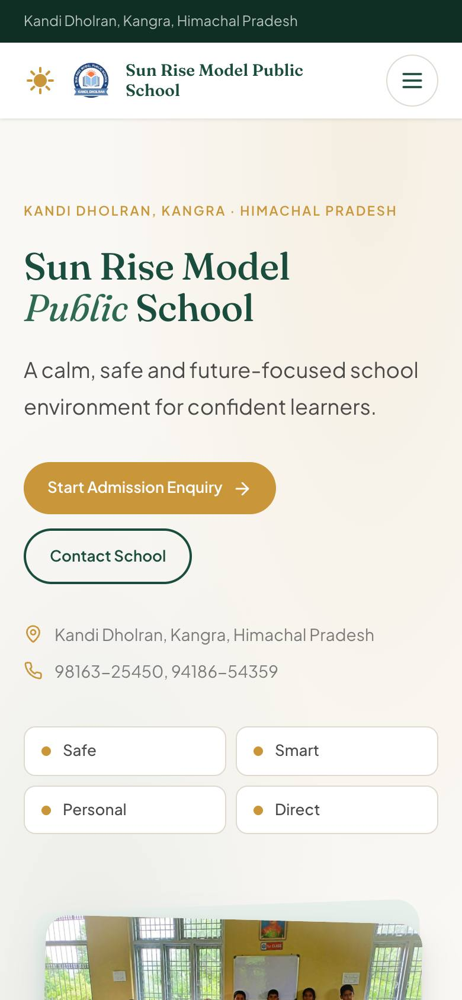

# Sun Rise Model Public School Website

> The website of Sun Rise Model Public School, Kandi Dholran (Kangra, Himachal Pradesh).

**Live:** [sunriseschoolkandi.org](https://sunriseschoolkandi.org/)

<p align="center">
  
  
  
</p>


Static redesign of `https://sunriseschoolkandi.org/` using React, Vite and Tailwind CSS.

## Information Architecture

- Home with premium hero, CTAs and school contact highlights
- About School
- Director / Founder message
- Academics
- Admissions
- Facilities
- Gallery
- Notices / Announcements
- Contact with preserved address, phone, email and Google Map
- Footer with important links

## Local Development

```bash
npm install
npm run dev
```

## Production Build

```bash
npm run build
```

The static output is generated in `dist/`.

## Firebase Hosting

`firebase.json` is configured to deploy the Vite static build from `dist`.

```bash
npm run build
firebase deploy
```

## Content Updates

Most school copy, contact details, notices, facilities and gallery references are in:

```text
src/data/siteContent.js
```

Reusable media from the previous website is stored in:

```text
public/assets
public/assets/gallery
```

## License

Code is released under the [MIT License](LICENSE). The school's name, logo, photographs and text belong to Sun Rise Model Public School and are not covered by the code license.
